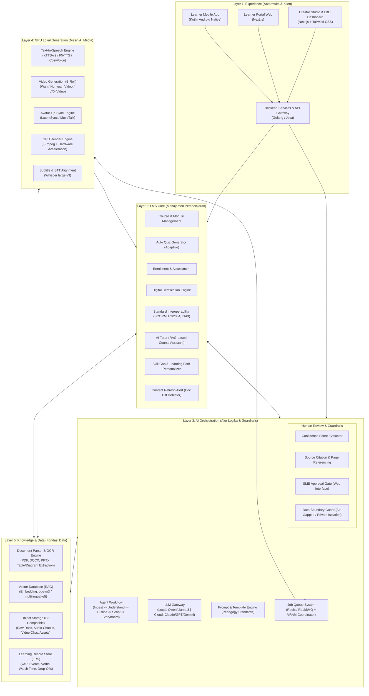
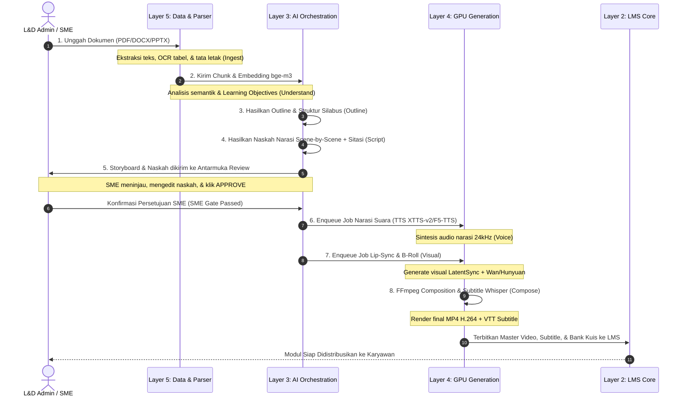
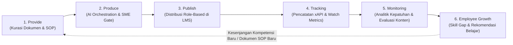
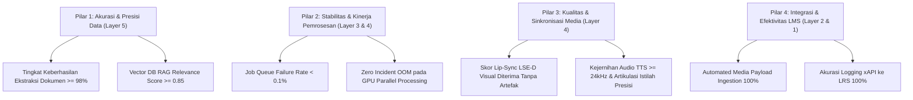
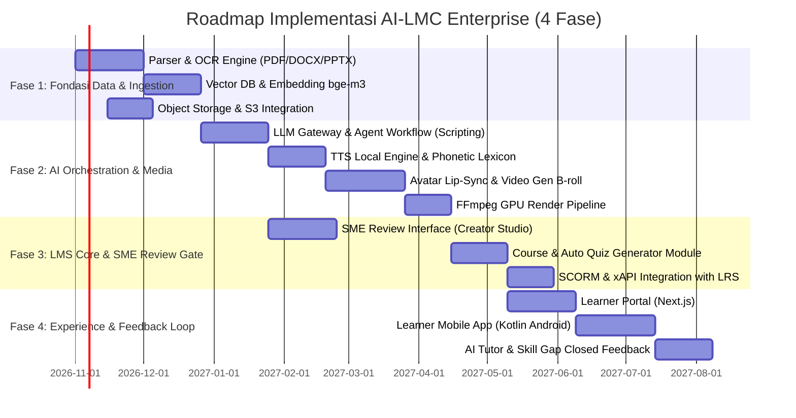

# Product Requirement Document (PRD)
# AI Learning Management & Creator untuk Enterprise (End-to-End)

---

## Informasi Dokumen
| Atribut | Keterangan |
| :--- | :--- |
| **Nama Produk** | AI Learning Management & Creator (AI-LMC) Enterprise |
| **Versi Dokumen** | 1.0.0 |
| **Status** | Approved / Ready for Architecture & Development |
| **Klasifikasi** | Enterprise Confidential / Internal Product Specification |
| **Target Deployment** | On-Premise GPU Infrastructure & Private Cloud |
| **Tanggal Pembuatan** | 29 Oktober 2026 |

---

## Daftar Isi
1. [Pendahuluan](#1-pendahuluan)
   - 1.1 [Latar Belakang](#11-latar-belakang)
   - 1.2 [Pernyataan Masalah (Problem Statement)](#12-pernyataan-masalah-problem-statement)
   - 1.3 [Tujuan Produk (Product Goals)](#13-tujuan-produk-product-goals)
   - 1.4 [Ruang Lingkup Produk (Scope & Boundaries)](#14-ruang-lingkup-produk-scope--boundaries)
   - 1.5 [Persona Pengguna (User Personas)](#15-persona-pengguna-user-personas)
2. [Arsitektur Sistem Keseluruhan (Layer 5 hingga Layer 1)](#2-arsitektur-sistem-keseluruhan-layer-5-hingga-layer-1)
   - 2.1 [Diagram Arsitektur Multi-Tier](#21-diagram-arsitektur-multi-tier)
   - 2.2 [Layer 5: Knowledge & Data (Fondasi Data)](#22-layer-5-knowledge--data-fondasi-data)
   - 2.3 [Layer 4: GPU Lokal Generation (Mesin AI Media)](#23-layer-4-gpu-lokal-generation-mesin-ai-media)
   - 2.4 [Layer 3: AI Orchestration (Pengendali Alur Logika & Guardrails)](#24-layer-3-ai-orchestration-pengendali-alur-logika--guardrails)
   - 2.5 [Layer 2: LMS Core (Manajemen Pembelajaran Enterprise)](#25-layer-2-lms-core-manajemen-pembelajaran-enterprise)
   - 2.6 [Layer 1: Experience (Antarmuka Pengguna & API Gateway)](#26-layer-1-experience-antarmuka-pengguna--api-gateway)
3. [Alur Kerja Inti: Pipeline Dokumen ke Video (8 Tahapan)](#3-alur-kerja-inti-pipeline-dokumen-ke-video-8-tahapan)
   - 3.1 [Diagram Alir Pipeline](#31-diagram-alir-pipeline)
   - 3.2 [Spesifikasi Rinci Tiap Tahap (Tahap 1 s/d 8)](#32-spesifikasi-rinci-tiap-tahap-tahap-1-sd-8)
4. [Siklus Hidup End-to-End Pembelajaran (6 Tahapan Utama)](#4-siklus-hidup-end-to-end-pembelajaran-6-tahapan-utama)
   - 4.1 [Diagram Siklus Hidup & Closed Feedback Loop](#41-diagram-siklus-hidup--closed-feedback-loop)
   - 4.2 [Deskripsi 6 Fase Lifecycle](#42-deskripsi-6-fase-lifecycle)
5. [Kebutuhan Non-Fungsional (Non-Functional Requirements / NFR)](#5-kebutuhan-non-fungsional-non-functional-requirements--nfr)
   - 5.1 [Keamanan, Privasi & Kepatuhan Enterprise](#51-keamanan-privasi--kepatuhan-enterprise)
   - 5.2 [Kinerja, Skalabilitas & Manajemen VRAM GPU](#52-kinerja-skalabilitas--manajemen-vram-gpu)
   - 5.3 [Keandalan, Ketersediaan & Penanganan Kegagalan](#53-keandalan-ketersediaan--penanganan-kegagalan)
   - 5.4 [Auditabilitas & Transparansi](#54-auditabilitas--transparansi)
6. [Spesifikasi Teknis & Rekomendasi Infrastruktur Hardware](#6-spesifikasi-teknis--rekomendasi-infrastruktur-hardware)
   - 6.1 [Rekomendasi Hardware Server GPU On-Premise](#61-rekomendasi-hardware-server-gpu-on-premise)
   - 6.2 [Matriks Teknologi & Model AI](#62-matriks-teknologi--model-ai)
7. [Metrik Keberhasilan Utama (Key Success Metrics)](#7-metrik-keberhasilan-utama-key-success-metrics)
8. [Matriks Risiko & Strategi Mitigasi](#8-matriks-risiko--strategi-mitigasi)
9. [Roadmap Implementasi & Rencana Rilis](#9-roadmap-implementasi--rencana-rilis)

---

## 1. Pendahuluan

### 1.1 Latar Belakang
Di lingkungan enterprise modern, kecepatan distribusi pengetahuan dan reskilling/upskilling karyawan menentukan kelincahan operasional dan keunggulan kompetitif organisasi. Perusahaan secara konstan menghasilkan ribuan dokumen operasional—mulai dari Standard Operating Procedure (SOP), dokumen kebijakan (policy), panduan regulasi, hingga *product knowledge*.

Namun, proses transformasi dokumen-dokumen statis tersebut menjadi materi pelatihan yang menarik, terstruktur, dan efektif saat ini terbentur pada proses manual yang memakan waktu, biaya tinggi, serta kesenjangan antara ketersediaan materi dengan kebutuhan riil kompetensi karyawan.

### 1.2 Pernyataan Masalah (Problem Statement)
Terdapat empat hambatan utama yang dihadapi organisasi skala enterprise:

1. **Produksi Konten yang Lambat & Mahal**:
   Pembuatan satu modul video pembelajaran interaktif berkualitas tinggi membutuhkan waktu 3–6 minggu serta melibatkan tim multidisiplin (Instructional Designer, Subject Matter Expert, Voiceover Artist, Videografer, Animator, dan Editor).
2. **Pengetahuan Terkunci (*Siloed Knowledge*)**:
   Ribuan dokumen SOP, pedoman teknis, dan kepatuhan tersimpan pasif dalam format dokumen (PDF, DOCX, PPTX). Format ini terbukti memiliki tingkat keterbacaan dan pemahaman yang sangat rendah di kalangan karyawan garis depan (*frontliners*) maupun staf operasional.
3. **LMS Pasif Tanpa Wawasan Mendalam**:
   Sistem Manajemen Pembelajaran (LMS) konvensional sekadar menjadi repositori penyimpanan berkas dan pelacak absensi dasar. LMS lama tidak memiliki kemampuan untuk menilai tingkat pemahaman konsep, mengukur retensi pengetahuan per bagian materi, atau memberikan rekomendasi jalur belajar yang adaptif dan personal.
4. **Keamanan Data Sensitif & Kepatuhan Kerahasiaan**:
   Penggunaan platform AI komersial publik berbasis cloud berisiko tinggi membocorkan rahasia dagang, data operasional rahasia, regulasi internal, serta kekayaan intelektual enterprise ke pihak ketiga.

### 1.3 Tujuan Produk (Product Goals)
Membangun platform **AI Learning Management & Creator (AI-LMC)** enterprise yang mampu:
- Mengotomatiskan konversi dokumen mentah internal (SOP, regulasi, *product knowledge*) menjadi video pembelajaran interaktif, materi instruksional modular, naskah narasi, serta kuis evaluasi secara mandiri.
- Menjalankan seluruh proses ekstraksi data, inferensi teks (LLM), sintesis audio (TTS), pembuatan video B-roll, serta sinkronisasi bibir avatar (*lip-sync*) di atas **infrastruktur lokal (*on-premise*)**, menjamin isolasi data tanpa kebocoran ke jaringan publik.
- Mengintegrasikan modul kreasi otomatis langsung dengan sistem inti LMS (LMS Core) dan Learning Record Store (LRS) berstandar industri (SCORM & xAPI) guna mewujudkan siklus pemantauan perkembangan kompetensi karyawan secara *closed-loop*.

### 1.4 Ruang Lingkup Produk (Scope & Boundaries)
Ruang lingkup PRD ini mencakup arsitektur end-to-end 5 layer:
- **Layer 5 (Knowledge & Data)**: Ekstraksi dokumen multi-format, OCR, pemrosesan chunking/embedding, Vector DB untuk RAG, S3 Object Storage, dan LRS (xAPI).
- **Layer 4 (GPU Lokal Generation)**: Model AI lokal untuk Text-to-Speech (TTS), Video Generation (B-roll), Avatar Lip-Sync, dan GPU Render Engine berbasis FFmpeg.
- **Layer 3 (AI Orchestration)**: Agent workflow pipeline naskah/storyboard, LLM Gateway (lokal & hybrid), Prompt Engine, Job Queue & VRAM scheduler, serta Human Review & Guardrails.
- **Layer 2 (LMS Core)**: Course management, auto-quiz generation, enrollment & role-based assignment, sertifikasi digital, integrasi SCORM/xAPI, AI Tutor, skill gap analysis, dan content refresh alert.
- **Layer 1 (Experience)**: Web Creator Studio & L&D Dashboard, Web Learner Portal, Mobile Learner App (Android Native), dan Backend Services / API Gateway.
- **Siklus Hidup Lengkap (6 Tahapan)**: Provide $\rightarrow$ Produce $\rightarrow$ Publish $\rightarrow$ Tracking $\rightarrow$ Monitoring $\rightarrow$ Employee Growth (dengan feedback loop ke Provide).

### 1.5 Persona Pengguna (User Personas)

| Persona | Peran Utama | Kebutuhan Utama | Nilai Tambah dari AI-LMC |
| :--- | :--- | :--- | :--- |
| **L&D Manager / Admin** | Pengelola kurikulum pelatihan & kepatuhan enterprise | Mempercepat siklus produksi kursus, memantau tingkat kelulusan & metrik retensi belajar tim | Mengurangi waktu produksi modul dari berminggu-minggu menjadi hitungan jam; analitik otomatis |
| **Subject Matter Expert (SME)** | Pemilik konten teknis (Engineering, SOP, Policy) | Memastikan keakuratan isi naskah, sitasi dokumen, dan terminologi teknis tanpa harus repot mengedit video manual | Antarmuka *review gate* terstruktur dengan penandaan sitasi sumber per scene |
| **Karyawan / Learner** | Konsumen materi pelatihan & peserta upskilling | Belajar materi teknis kompleks secara cepat, interaktif, mudah diakses melalui mobile/web | Video pembelajaran ringkas dengan avatar, asisten AI Tutor 24/7, kuis adaptif |
| **HR & Division Head** | Pemantau kompetensi & perencanaan talenta | Memetakan skill gap divisi, merencanakan karier, memastikan sertifikasi kepatuhan terpenuhi | Laporan analitik skill gap otomatis dan rekomendasi modul berdasarkan performa riil |
| **IT & Security Officer** | Penjaga kedaulatan data & infrastruktur enterprise | Mencegah kebocoran data rahasia ke cloud, menjaga stabilitas server GPU lokal | Isolasi penuh *on-premise*, data boundary guard, penanganan job queue anti-OOM |

---

## 2. Arsitektur Sistem Keseluruhan (Layer 5 hingga Layer 1)

### 2.1 Diagram Arsitektur Multi-Tier

---

### 2.2 Layer 5: Knowledge & Data (Fondasi Data)
Lapisan terbawah yang bertindak sebagai fondasi penyimpanan, pengindeksan, ekstraksi pengetahuan terstruktur, serta repositori aktivitas belajar.

#### 1. Document Parser & OCR Engine
- **Dukungan Format Dokumen**: Mampu membaca dan mengurai format enterprise standar: `.pdf` (digital dan hasil scan), `.docx`, dan `.pptx`.
- **Komponen OCR Terintegrasi**: Menggunakan OCR berbasis AI (seperti PaddleOCR / Surya OCR) untuk mengenali teks pada citra, tangkapan layar, bagan alur, dan diagram skematik.
- **Preservasi Tata Letak (Layout-Aware Parsing)**: Mengekstrak tabel kompleks, hierarki heading (H1-H4), poin-poin (bullet points), serta keterangan gambar (*caption*) dengan mempertahankan hubungan semantik dan metadata nomor halaman.

#### 2. Vector Database (Vector DB) & Embedding Lokal
- **Fungsi Utama**: Mendukung mekanisme Retrieval-Augmented Generation (RAG) untuk pencarian fakta yang akurat, pembentukan outline kursus, pembuatan naskah, dan asisten AI Tutor.
- **Mekanisme Chunking**: Segmentasi dokumen berbasis semantik dan tata letak (*semantic/recursive chunking*) dengan ukuran chunk dinamis (500–1000 token) serta *overlap* sebesar 15–20% untuk menjaga kesinambungan konteks antar kalimat.
- **Model Embedding Lokal**: Beroperasi sepenuhnya di lingkungan lokal menggunakan model open-source berkinerja tinggi:
  - `BAAI/bge-m3`: Mendukung dense retrieval, sparse retrieval, dan multi-vektor, dengan pemahaman tinggi terhadap Bahasa Indonesia dan Inggris serta context window hingga 8.192 token.
  - `multilingual-e5-large`: Alternatif tangguh untuk pemetaan semantik dokumen multibahasa.
- **Mesin Vector DB**: Didukung oleh mesin seperti Qdrant, Milvus, atau pgvector terisolasi pada cluster enterprise.

#### 3. Object Storage (S3-Compatible)
- **Fungsi**: Repositori terpusat untuk berkas biner statis berskala besar.
- **Kategori Aset yang Disimpan**:
  - Dokumen sumber mentah (*raw files*) dan metadata versi.
  - Aset visual hasil ekstraksi dokumen (diagram, ikon, foto produk).
  - Berkas audio narasi per adegan (format `.wav` 24kHz / `.mp3`).
  - Klip visual B-roll dan klip video avatar hasil render per adegan.
  - Master berkas video pembelajaran final (format `.mp4` H.264/H.265) beserta berkas subtitle (`.vtt`, `.srt`).
- **Implementasi**: MinIO On-Premise Cluster atau Ceph Object Storage dengan enkripsi *at-rest* (AES-256).

#### 4. Learning Record Store (LRS)
- **Fungsi**: Mengumpulkan, menyimpan secara persisten, dan mengagregasi data jejak aktivitas belajar seluruh karyawan berdasarkan standar formal **xAPI (Experience API / Tin Can API)**.
- **Spesifikasi Statement xAPI**: Mencatat relasi `Actor - Verb - Object - Result - Context`.
- **Metrik Terlacak Rinci**:
  - `experienced`: Pembelajar membuka modul/scene.
  - `watched`: Durasi tontonan video riil, termasuk deteksi *skipping*, *seeking*, atau pemutaran berulang.
  - `interacted`: Pembelajar mengklik hotspot interaktif atau membuka materi tambahan.
  - `answered`: Pembelajar menjawab pertanyaan kuis, termasuk pencatatan pilihan jawaban dan waktu respon.
  - `passed` / `failed`: Status kelulusan tes evaluasi beserta nilai skor akhir.
  - `completed`: Penyelesaian modul pembelajaran secara penuh (100% video selesai + kuis tuntas).

---

### 2.3 Layer 4: GPU Lokal Generation (Mesin AI Media)
Lapisan komputasi intensif yang beroperasi seutuhnya di atas infrastruktur server GPU on-premise perusahaan tanpa ketergantungan pada API cloud pihak ketiga.

#### 1. Text-to-Speech (TTS) Engine
- **Fungsi**: Mengonversi teks naskah per adegan menjadi sinyal audio suara manusia dengan intonasi alami, artikulasi jelas, jeda bernapas (*breathing pause*), dan penekanan kata (*prosody*) yang tepat.
- **Dukungan Bahasa**: Dioptimalkan untuk **Bahasa Indonesia formal/instruksional** serta **Bahasa Inggris** (termasuk pemahaman akurat atas istilah teknis / akronim bisnis).
- **Kandidat Model Lokal**:
  - `XTTS-v2`: Dukungan *voice cloning* berkualitas tinggi hanya dengan sampel audio referensi 6–10 detik; intonasi ekspresif multibahasa.
  - `F5-TTS`: Model non-autoregressive berbasis Flow Matching, sangat cepat dengan latensi rendah dan kejernihan audio tinggi.
  - `CosyVoice`: Model mutakhir dengan kontrol emosi dan sintesis suara natural multi-aksen.
- **Standar Output**: Format WAV/MP3, minimum sample rate 24kHz, 16-bit mono/stereo.

#### 2. Video Generation (Visual B-Roll)
- **Fungsi**: Menghasilkan adegan visual pendukung (*B-roll*), ilustrasi konsep animasi, atau latar belakang dinamis yang relevan dengan naskah adegan saat narator menjelaskan topik teknis.
- **Kandidat Model Lokal**:
  - `Wan 2.1`: Model video generation open-source terkini dengan ketajaman visual tinggi dan kemampuan teks-ke-video (*text-to-video*) yang presisi.
  - `Hunyuan Video`: Arsitektur Transformer difusi video beresolusi tinggi (720p/1080p) dengan konsistensi fisik gerak yang stabil.
  - `LTX-Video`: Model difusi video berkecepatan tinggi, dioptimalkan untuk inferensi cepat pada GPU server.
- **Integrasi Fallback**: Mengombinasikan cuplikan B-roll generatif dengan aset statis hasil ekstraksi dokumen (diagram, tabel, skema arsitektur) yang dianimasikan menggunakan efek gerak dinamis (*Ken Burns effect* / *pan-and-zoom*).

#### 3. Avatar Lip-Sync Engine
- **Fungsi**: Menggerakkan wajah dan menyinkronkan gerakan bibir (*lip synchronisation*) dari karakter presenter virtual (avatar 2D/3D fotorealistik atau korporat) agar selaras dengan audio suara narasi yang dihasilkan TTS.
- **Kandidat Model Lokal**:
  - `LatentSync`: Model sinkronisasi bibir berbasis difusi ruang laten (*latent space*), menghasilkan pergerakan mulut yang tajam tanpa keburaman (*motion blur*) di sekitar bibir dan dagu.
  - `MuseTalk`: Arsitektur real-time inpainting dengan penyesuaian ekspresi wajah dan kedipan mata alami tanpa artefak distorsi.
- **Input & Output**: Menerima video avatar dasar (*neutral loop/talking head*) dan berkas audio WAV; menghasilkan berkas video presenter dengan lip-sync berpresisi tinggi.

#### 4. Subtitle & STT Alignment Engine
- **Fungsi**: Menghasilkan transkrip teks dan *word-level timestamp* untuk sinkronisasi teks takarir (closed caption / subtitle).
- **Model**: Menggunakan `Whisper large-v3` yang di-hosting secara lokal untuk mentranskripsi kembali audio hasil TTS guna memperoleh stempel waktu presisi per kata (*word-level timestamps*).
- **Format Output**: Berkas subtitle `.vtt` dan `.srt`.

#### 5. Render Engine (Media Processing Pipeline)
- **Fungsi**: Mengorkestrasi penggabungan (*compositing*) seluruh komponen multimedia per adegan menjadi berkas master video pembelajaran MP4 tunggal.
- **Komponen yang Digabungkan**:
  - Video klip avatar presenter (dengan masking latar belakang / picture-in-picture / split screen).
  - Klip visual B-roll atau slide grafis animasi.
  - Efek transisi halus antar-scene (cross-fade, wipe, zoom slide).
  - Trek vokal narasi audio (TTS) yang telah dinormalisasi tingkat volumenya (-16 LUFS standar video web).
  - Trek musik latar (*background music*) lembut dengan otomatisasi *audio ducking* saat narator berbicara.
  - Trek takarir (subtitle) yang dapat dihidup-matikan (*soft subtitles*) maupun dibakar langsung (*hardcoded subtitles*).
- **Teknologi**: Pipeline berbasis **FFmpeg** dengan akselerasi perangkat keras NVIDIA NVENC/NVDEC untuk pemrosesan render yang sangat cepat dan efisien.

---

### 2.4 Layer 3: AI Orchestration (Pengendali Alur Logika & Guardrails)
Pusat kendali logika yang menghubungkan data mentah dengan mesin AI, mengelola alur kerja instruksional terstruktur, mengatur antrean kerja komputasi berat, serta memberlakukan batasan kepatuhan dan keselamatan data.

#### 1. Agent Workflow
Mengatur siklus hidup instruksional secara modular melalui agen terkoordinasi:
- **Analyzer Agent**: Menganalisis dokumen sumber, mengidentifikasi struktur topik, target pembaca, dan mengekstraksi tujuan pembelajaran terukur (*Learning Objectives*) berbasis Taksonomi Bloom.
- **Curriculum & Outline Agent**: Menyusun silabus, modul, dan daftar bab secara kronologis dan pedagogis.
- **Scriptwriter Agent**: Menulis naskah narasi per adegan (*scene-by-scene script*) dengan gaya bahasa profesional enterprise, panduan durasi per adegan, serta penandaan sitasi sumber dokumen.
- **Storyboard Agent**: Merancang arahan visual teknis untuk tiap adegan: apakah menampilkan avatar penuh, avatar *picture-in-picture*, slide teks rangkuman, diagram hasil ekstrak, atau B-roll generatif.
- **Quiz Formulation Agent**: Menyusun bank soal kuis (pilihan ganda, benar/salah, studi kasus) beserta penjelasan kunci jawaban dan referensi halaman dokumen.

#### 2. LLM Gateway & Abstraksi Model
- **Fungsi**: Lapisan abstraksi terpadu (*Unified Interface*) yang memungkinkan sistem memanggil model bahasa secara fleksibel.
- **Model Lokal (On-Premise Prioritas)**:
  - `Qwen 2.5 (14B / 32B / 72B Instruct)`: Performa sangat tinggi dalam penalaran logika, pemahaman konteks panjang, dan penguasaan Bahasa Indonesia formal.
  - `Llama 3.1 / 3.3 (8B / 70B Instruct)`: Model umum dengan stabilitas pemformatan JSON/struktural yang matang.
- **Model Cloud (Hybrid Opsional untuk Data Non-Sensitif)**: Dukungan integrasi ke API eksternal (Claude 3.5 Sonnet, GPT-4o, Gemini 1.5 Pro) dengan konfigurasi manual oleh administrator jika enterprise mengizinkan pemrosesan data umum/publik.
- **Format Output Terstruktur**: Memaksa keluaran LLM selalu mengikuti schema JSON (*JSON Schema Enforcement*) untuk mencegah kesalahan parsing pada alur kerja hilir.

#### 3. Prompt & Template Engine
- Perpustakaan prompt terstandarisasi untuk berbagai tipe modul pelatihan:
  - *Compliance & Safety Training* (fokus pada aturan ketat, sanksi, dan langkah pencegahan).
  - *Standard Operating Procedure (SOP) Walkthrough* (fokus pada instruksi langkah-demi-langkah berurutan).
  - *Product Knowledge & Technical Deep-Dive* (fokus pada fitur, keunggulan, spesifikasi teknis, dan studi kasus penanganan masalah).
- Standar pedagogi yang memastikan video tidak monoton, membatasi durasi per adegan maksimum 30–60 detik, dan durasi total modul antara 3–7 menit (*micro-learning standard*).

#### 4. Job Queue System & VRAM Management
- **Teknologi**: Berbasis **Redis + Celery** atau **RabbitMQ**.
- **Fungsi Utama**:
  - Mengelola antrean komputasi berat untuk pemrosesan Layer 4 (TTS, Lip-sync, Video Gen, FFmpeg rendering).
  - Menerapkan mekanisme prioritas (*priority queue*): prioritas tinggi untuk revisi scene tunggal oleh SME, prioritas reguler untuk modul baru.
  - **GPU VRAM Coordinator**: Mencegah kegagalan memori (*Out-of-Memory / OOM*). Scheduler mengatur agar model AI yang membutuhkan VRAM besar (misalnya Wan/Hunyuan Video dan Lip-sync) tidak dieksekusi bersamaan pada GPU fisik yang sama. Model di-load dan di-unload secara pintar (*dynamic model offloading*).

#### 5. Human Review & Enterprise Guardrails
Mekanisme pengawasan ketat untuk memastikan materi yang dihasilkan AI akurat, faktual, dan dapat dipertanggungjawabkan:
- **Confidence Score Indicator**: AI memberikan skor keyakinan (0–100%) terhadap fakta yang disajikan pada setiap adegan naskah. Jika skor di bawah 80%, sistem menandai adegan tersebut dengan peringatan kuning untuk diperiksa manual oleh SME.
- **Sitasi Sumber Wajib (*Mandatory Grounding & Citations*)**: Setiap klaim, angka, regulasi, dan instruksi dalam naskah wajib memiliki rujukan eksplisit ke dokumen asal: `[Nama_Dokumen.pdf, Halaman: X, Paragraf: Y]`. Pengguna dapat mengklik sitasi untuk melihat potongan dokumen asli secara instan.
- **SME Approval Gate**: Titik henti wajib (*hard checkpoint*) pada alur kerja. Proses komputasi berat di Layer 4 (TTS, Lip-sync, dan video rendering) **tidak akan dimulai** sebelum naskah dan storyboard disetujui (*Approved*) oleh Subject Matter Expert atau Tim L&D melalui dashboard antarmuka review.
- **Data Boundary Guard**: Pemeriksaan lapisan keamanan yang memastikan isolasi penuh. Seluruh data teks, prompt, dan media tidak pernah dikirim ke luar jaringan privat enterprise (kecuali secara eksplisit diizinkan untuk model cloud pada materi non-rahasia).

---

### 2.5 Layer 2: LMS Core (Manajemen Pembelajaran Enterprise)
Modul inti manajemen pembelajaran yang menerima produk akhir dari Layer 4 dan Layer 3, mengelolanya menjadi kurikulum terstruktur, mendistribusikannya ke karyawan, serta mengevaluasi pemahaman belajar.

#### 1. Course & Module Management
- Mengonsumsi aset hasil render AI secara otomatis tanpa perlu unggah berkas manual oleh admin.
- Mengemas video MP4, berkas takarir multi-bahasa (.vtt), dokumen bacaan pendukung, dan bank soal kuis ke dalam struktur bab (*chapter*) dan modul yang rapi.
- **Auto Quiz Generator**:
  - Menghasilkan kuis evaluasi komprehensif berdasarkan materi video secara otomatis.
  - Menentukan tingkat kesulitan adaptif (dasar, menengah, lanjut) yang disesuaikan dengan profil karyawan atau tingkat kompleksitas SOP.
  - Menyediakan *rationalization feedback*: saat karyawan salah menjawab, sistem menampilkan penjelasan mengapa jawaban tersebut salah beserta penanda waktu (*timestamp*) di menit video yang membahas konsep tersebut.

#### 2. Enrollment & Assessment Management
- Pendaftaran otomatis (*automated enrollment*) berdasarkan sinkronisasi direktori pengguna (integrasi HRIS / Active Directory / LDAP) menurut departemen, jabatan, lokasi kantor, atau level senioritas.
- Pengaturan jadwal pembelajaran wajib, tenggat waktu penyelesaian (*due date*), serta siklus evaluasi berkala (*recurring compliance assessment*).

#### 3. Sertifikasi Digital Otomatis
- Penerbitan sertifikat digital resmi instan begitu karyawan memenuhi kriteria kelulusan (menyelesaikan tontonan 100% dan mencapai nilai passing grade kuis, misalnya $\ge 80\%$).
- Sertifikat dilengkapi kode verifikasi QR-Code unik dan metadata riwayat audit kelulusan.

#### 4. Standard Interoperability (SCORM & xAPI)
- Kemampuan mengekspor paket kursus yang dihasilkan ke dalam format standar industri: **SCORM 1.2** dan **SCORM 2004 (3rd & 4th Edition)**.
- Integrasi penuh dengan protokol **xAPI** untuk pelaporan analitik aktivitas granular ke Learning Record Store (LRS) internal maupun eksternal.

#### 5. Fitur AI Lanjutan LMS
- **AI Tutor (Personal Course Assistant)**:
  - Antarmuka chat interaktif yang disematkan langsung di samping pemutar video pembelajaran.
  - Memanfaatkan RAG lokal yang dibatasi hanya pada konteks modul kursus yang sedang ditonton dan dokumen sumber pendukung.
  - Mampu menjawab pertanyaan klarifikasi pembelajar secara instan dan mengarahkan pembelajar ke *timestamp* video yang relevan.
- **Rekomendasi Jalur Belajar Personal (*Personalized Learning Path*)**:
  - Algoritma rekomendasi yang menganalisis riwayat nilai kuis, kebiasaan belajar, dan kompetensi jabatan karyawan untuk menyarankan modul lanjutan yang relevan.
- **Analisis Kesenjangan Keterampilan (*Skill Gap Analysis*)**:
  - Pemetaan matriks kompetensi antara keahlian yang disyaratkan oleh divisi/jabatan dengan pemahaman riil yang ditunjukkan karyawan melalui hasil evaluasi kuis.
  - Dasbor agregat bagi manajemen untuk melihat area kelemahan pengetahuan di tingkat tim atau departemen.
- **Content Refresh Alert (Peringatan Pembaruan Konten)**:
  - Sistem pengawas dokumen di Layer 5 secara berkala memantau perubahan versi dokumen SOP sumber.
  - Jika dokumen sumber diunggah versi barunya (misal: `SOP_Keuangan_v2.pdf` menggantikan `v1.pdf`), sistem mendeteksi perbedaan teks (*diffing*) secara semantik dan mengirimkan notifikasi kepada tim L&D untuk meninjau dan meregenerasi adegan video yang terdampak saja secara modular (*incremental regeneration*).

---

### 2.6 Layer 1: Experience (Antarmuka Pengguna & API Gateway)
Lapisan interaksi utama bagi pengguna akhir (kreator L&D, kurator SME, manajemen HR, dan pembelajar).

#### 1. Creator Studio & L&D Dashboard
- **Teknologi**: **Next.js (App Router)** dan **Tailwind CSS**.
- **Fungsi Utama**:
  - *Document Ingestion Hub*: Antarmuka seret-lepas (*drag-and-drop*) dokumen, pemilihan kategori pengetahuan, dan penandaan tingkat kerahasiaan.
  - *AI Generation Workspace*: Visualisasi progres pipeline (tahap Ingest, Outline, Script, Storyboard).
  - *SME Review & Edit Interface*: Editor naskah WYSIWYG per adegan dengan tampilan belah layar (*split screen*) antara naskah AI dan dokumen PDF sumber bertanda sitasi aktif.
  - *Analytics Dashboard*: Grafik metrik adopsi kursus, rata-rata skor kelulusan, dan visualisasi retensi penonton.

#### 2. Learner Portal (Web)
- **Teknologi**: **Next.js (React)** dengan arsitektur responsif desktop dan tablet.
- **Fungsi Utama**:
  - Katalog kursus terdaftar (*My Courses*) dan rekomendasi jalur belajar.
  - *Interactive Video Player*: Pemutar video kustom dengan dukungan subtitle, kontrol kecepatan, penanda bab (*chapter markers*), dan panel samping AI Tutor.
  - Modul pengerjaan kuis interaktif dengan umpan balik langsung.
  - Unduhan sertifikat digital dan profil pencapaian kompetensi (*Skill Passport*).

#### 3. Learner App (Mobile Native)
- **Teknologi**: **Kotlin (Android Native)**.
- **Fungsi Utama**:
  - Akses *micro-learning* fleksibel di mana saja bagi karyawan operasional di lapangan.
  - Pemutar video native dengan akselerasi perangkat keras (ExoPlayer).
  - Fitur unduh luring (*offline playback*) dengan enkripsi berkas lokal untuk materi wajib lapangan.
  - Sinkronisasi peristiwa belajar (xAPI tracking) secara otomatis ke server saat ponsel kembali terhubung ke jaringan WiFi enterprise.

#### 4. Backend Services & API Gateway
- **Teknologi**: **Golang** (untuk performa tinggi, concurrency rendah latensi) atau **Java (Spring Boot Enterprise)**.
- **Fungsi Utama**:
  - *API Gateway & Authentication*: Manajemen autentikasi SSO (OAuth2 / SAML / OIDC / LDAP), manajemen sesi JWT, dan kontrol akses berbasis peran (*Role-Based Access Control / RBAC*).
  - *Service Dispatcher*: Mengarahkan permintaan klien ke LMS Core (Layer 2) dan AI Orchestration (Layer 3).
  - *Event & Job Broker*: Mengelola komunikasi antar-layanan melalui WebSockets (untuk pembaruan status render video secara real-time ke UI) dan message broker antrean tugas.

---

## 3. Alur Kerja Inti: Pipeline Dokumen ke Video (8 Tahapan)

### 3.1 Diagram Alir Pipeline

---

### 3.2 Spesifikasi Rinci Tiap Tahap (Tahap 1 s/d 8)

| Tahap | Nama Tahap | Penanggung Jawab | Deskripsi Proses & Spesifikasi Teknis | Input Data | Output Data | Kriteria Validasi & Toleransi Error |
| :---: | :--- | :--- | :--- | :--- | :--- | :--- |
| **1** | **Ingest** | Layer 5 (Lokal) | Penguraian dokumen sumber melalui Document Parser dan OCR Engine. Teks dibersihkan dari artefak, diagram/tabel diekstraksi ke citra beresolusi tinggi, dan hierarki dokumen dipetakan. | File mentah `.pdf`, `.docx`, atau `.pptx` | Teks terstruktur Markdown/JSON, metadata halaman, aset gambar terpisah | Tingkat keberhasilan ekstraksi karakter dan struktur minimum 98%. Tidak boleh ada teks penting yang terpotong. |
| **2** | **Understand** | Layer 5 & Layer 3 | Pemotongan teks semantik (*chunking* 512–1024 token), pembuatan embedding lokal via `bge-m3`, penyimpanan indeks di Vector DB, serta ekstraksi topik kunci dan *Learning Objectives* (Taksonomi Bloom). | Teks terstruktur dari Tahap 1 | Vektor embedding terindeks, daftar learning objectives terverifikasi | Relevansi hasil retrieval Vector DB minimum cosine similarity 0.85 terhadap kata kunci esensial. |
| **3** | **Outline** | Layer 3 (LLM) | Agen Kurikulum menyusun kerangka modul pembelajaran, daftar bab, alur naratif kronologis, dan estimasi alokasi waktu per modul (3–5 menit per modul). | Learning objectives & konteks dokumen | JSON Outline berformat terstandarisasi (Bab, Sub-bab, Tujuan) | Format keluaran mematuhi skema JSON 100%; cakupan topik mencakup seluruh tujuan belajar. |
| **4** | **Script** | Layer 3 (LLM) | Agen Penulis Naskah menghasilkan teks naskah narasi per adegan (*scene-by-scene script*) dalam gaya bahasa formal korporat, lengkap dengan penandaan sitasi sumber dokumen. | JSON Outline & potongan konteks RAG | Naskah adegan detail: teks narasi, durasi perkiraan, penanda sitasi `[Doc_P.X]` | Setiap adegan wajib memiliki sitasi dokumen sumber yang valid. Confidence score fakta $\ge 80\%$. |
| **5** | **Storyboard** | Layer 3 & SME | Penentuan arahan visual teknis (pilihan karakter avatar, tata letak *split-screen/PIP*, teks judul di layar, dan deskripsi *prompt* B-roll). Naskah disajikan kepada SME untuk ditinjau, diedit, dan disetujui. | Naskah adegan dari Tahap 4 | Storyboard final yang berstatus **APPROVED** oleh SME | Titik henti wajib (*Hard Gate*). Komputasi Layer 4 tidak boleh jalan sebelum tanda tangan digital persetujuan SME. |
| **6** | **Voice** | Layer 4 (GPU Lokal) | Naskah narasi yang telah disetujui diubah menjadi audio vokal berkejelasan tinggi menggunakan model TTS lokal (`XTTS-v2` / `F5-TTS` / `CosyVoice`). | Teks narasi per scene dari naskah final | File audio `.wav` lossless 24kHz / 16-bit per scene | Artikulasi istilah teknis Bahasa Indonesia tepat; audio bebas dari distorsi robotik atau desis. |
| **7** | **Visual** | Layer 4 (GPU Lokal) | Generator avatar lokal (`LatentSync` / `MuseTalk`) menyelaraskan bibir avatar dengan audio narasi. Bersamaan dengan itu, model video lokal (`Wan 2.1` / `Hunyuan Video`) merender visual B-roll dinamis. | File audio narasi & prompt visual storyboard | Klip video avatar lip-sync (`.mp4`) & klip visual B-roll (`.mp4`) | Metrik sinkronisasi bibir LSE-D visual dapat diterima; pergerakan wajah alami tanpa distorsi geometris. |
| **8** | **Compose** | Layer 4 & Layer 2 | Mesin render berbasis FFmpeg menggabungkan video avatar, klip B-roll, transisi halus, audio narasi ternormalisasi, musik latar (*ducked*), dan subtitle yang di-generate via Whisper large-v3 menjadi video MP4 utuh. Modul diterbitkan langsung ke LMS Core. | Seluruh aset media scene dari Tahap 6 & 7 | File video final `course_module.mp4`, `subtitles.vtt`, dan paket bank soal JSON | Video 1080p H.264/AAC stabil; audio terintegrasi sinkron $\pm 20\text{ms}$; otomatis terindeks di database LMS Core. |

---

## 4. Siklus Hidup End-to-End Pembelajaran (6 Tahapan Utama)

Platform AI-LMC dirancang bukan sekadar sebagai alat render video satu arah, melainkan sebagai ekosistem pembelajaran tertutup (*closed-loop lifecycle*) yang terus memperbarui diri berdasarkan kebutuhan kompetensi organisasi.

### 4.1 Deskripsi 6 Fase Lifecycle

#### Fase 1: Provide (Penyediaan & Kurasi Data)
- **Aktivitas**: Tim L&D dan departemen pemilik materi (Engineering, Compliance, Sales, Operasional) mengunggah dokumen sumber (SOP baru, revisi kebijakan, manual produk) ke dalam Knowledge Base enterprise.
- **Validasi**: Penentuan status kerahasiaan dokumen, metadata kepemilikan materi, dan pemilihan template pedagogi yang sesuai.
- **Penanggung Jawab (Owner)**: Tim L&D dan Subject Matter Expert (SME).

#### Fase 2: Produce (Produksi Berbasis AI & Review SME)
- **Aktivitas**: Eksekusi AI Orchestration di Layer 3 dan Layer 4 untuk menghasilkan draf outline, naskah narasi, storyboard, audio TTS, visual B-roll, dan auto quiz.
- **Review Kritis**: SME meninjau akurasi naskah di antarmuka khusus, melakukan perbaikan kalimat jika diperlukan, dan memberikan persetujuan formal (*SME Approval Gate*). Setelah disetujui, GPU Render Engine mengompilasi video pembelajaran final.
- **Penanggung Jawab (Owner)**: Mesin AI (Layer 3 & 4) dan SME (Verifikator).

#### Fase 3: Publish (Penerbitan & Penugasan Otomatis)
- **Aktivitas**: Modul pembelajaran yang telah lolos render diterbitkan langsung ke dalam katalog LMS Core.
- **Penugasan Cerdas (*Smart Assignment*)**: Admin L&D menentukan target audiens. Sistem secara otomatis mendaftarkan (*auto-enroll*) karyawan yang relevan berdasarkan atribut profil jabatan, unit bisnis, atau status kepatuhan berkala melalui integrasi direktori karyawan.
- **Penanggung Jawab (Owner)**: L&D Administrator.

#### Fase 4: Tracking (Pelacakan Perilaku Belajar Granular)
- **Aktivitas**: Selama pembelajar berinteraksi dengan materi di Web Portal atau Mobile App, sistem mencatat seluruh jejak peristiwa belajar secara otomatis dan tanpa henti.
- **Data yang Dikumpulkan**:
  - Durasi pemutaran riil dan kecepatan tonton.
  - Titik henti keluar (*drop-off timestamp*) di setiap scene video untuk mendeteksi bagian materi yang membosankan atau membingungkan.
  - Jumlah percobaan kuis, pilihan jawaban salah, dan durasi respon per butir soal.
  - Riwayat pertanyaan yang diajukan ke asisten AI Tutor.
- **Standar**: Ditransmisikan secara real-time ke Learning Record Store (LRS) dalam format xAPI statement.
- **Penanggung Jawab (Owner)**: Sistem Tracking Otomatis (Layer 2 & Layer 5).

#### Fase 5: Monitoring (Pemantauan Kepatuhan & Efektivitas Konten)
- **Aktivitas**: Dasbor analitik otomatis menyajikan wawasan komprehensif kepada tim L&D, HR Business Partner, dan pimpinan divisi.
- **Indikator Kunci yang Dipantau**:
  - *Compliance Rate*: Persentase penyelesaian modul wajib per divisi sebelum tenggat waktu.
  - *Content Drop-off Heatmap*: Deteksi adegan video yang memiliki tingkat drop-off tinggi (indikasi materi terlalu rumit atau penyampaian bertele-tele).
  - *Quiz Question Difficulty Index*: Mengidentifikasi butir soal yang memiliki tingkat kegagalan ekstrem untuk evaluasi kejelasan materi instruksional.
- **Penanggung Jawab (Owner)**: Tim L&D dan HR Management.

#### Fase 6: Employee Growth (Pertumbuhan Karyawan & Feedback Loop)
- **Aktivitas**:
  - Pemetaan kesenjangan keterampilan (*Skill Gap Mapping*) individual dan organisasional.
  - Penerbitan sertifikat kompetensi digital bagi karyawan yang lulus evaluasi.
  - Sistem AI Tutor merekomendasikan modul pengayaan (*micro-learning path*) untuk memperdalam topik yang nilainya masih marjinal.
- **Closed Feedback Loop**: Apabila analitik mendeteksi kesenjangan keterampilan massal pada suatu topik tertentu, atau saat dokumen SOP di lapangan mengalami revisi berkala, sistem secara proaktif memicu pembuatan tugas (*trigger task*) kembali ke **Fase 1 (Provide)** untuk memproduksi modul pembelajaran baru atau modul pembaruan yang tepat sasaran.
- **Penanggung Jawab (Owner)**: Karyawan, Manajer Divisi, dan Tim Perencana Talenta L&D.

---

## 5. Kebutuhan Non-Fungsional (Non-Functional Requirements / NFR)

### 5.1 Keamanan, Privasi & Kepatuhan Enterprise
- **Data Boundary Guard (Isolasi Penuh)**: Seluruh pemrosesan teks sensitif, pembentukan vektor embedding, sintesis suara, dan rendering video wajib berjalan di atas jaringan tertutup (*air-gapped* atau *isolated enterprise intranet*). Tidak ada payload data dokumen internal yang boleh dialirkan ke server eksternal publik.
- **Role-Based Access Control (RBAC)**: Pembatasan hak akses berbasis peran yang ketat (Super Admin, L&D Creator, SME Reviewer, Department Manager, dan Learner).
- **Enkripsi Data**: Enkripsi berkas *at-rest* menggunakan AES-256 pada Object Storage dan database, serta enkripsi *in-transit* menggunakan TLS 1.3 untuk seluruh komunikasi jaringan antar-layer.
- **Audit Logging**: Pencatatan riwayat audit lengkap (siapa mengunggah dokumen, siapa menyetujui storyboard, perubahan versi naskah, dan waktu kelulusan sertifikasi).

### 5.2 Kinerja, Skalabilitas & Manajemen VRAM GPU
- **Isolasi Alokasi Memori GPU (Anti-OOM Strategy)**:
  - Setiap tugas inferensi GPU di Layer 4 (TTS, Lip-sync, Video Generation) dijalankan dalam kontainer terisolasi dengan batas VRAM yang terdefinisi ketat (*hard memory limit*).
  - Penjadwal tugas (*Queue Scheduler*) dilarang memicu proses Video Generation (Wan/Hunyuan) dan Avatar Lip-Sync secara bersamaan pada kartu GPU fisik yang sama jika total alokasi memori melampaui 85% kapasitas VRAM fisik.
- **Throughput Pemrosesan Video**:
  - Target durasi render total untuk satu modul video mikro (durasi 3 menit) adalah **$\le 15$ menit** dari titik persetujuan SME hingga terbit di LMS Core (berdasarkan spesifikasi 2 unit NVIDIA RTX 4090 / A6000).
- **Konkurensi Pengguna**:
  - Learner Portal Web & Mobile App mampu menangani minimum **1.000 pengguna aktif bersamaan (*concurrent learners*)** tanpa penurunan latensi pemutaran video (didukung *Content Caching* lokal dan streaming berbasis HLS).

### 5.3 Keandalan, Ketersediaan & Penanganan Kegagalan
- **Job Failure Resilience**: Tingkat kegagalan antrean tugas (*job queue failure rate*) harus berada di bawah **0.1%**.
- **Retry Mechanism**: Jika terjadi kegagalan render pada salah satu scene (misalnya timeout minor pada model Lip-sync), sistem melakukan mekanisme *retry* otomatis maksimal 3 kali untuk scene tersebut tanpa harus mengulang proses render dari scene pertama (*incremental scene rendering*).
- **Ketersediaan Sistem (High Availability)**: Target SLA operasional untuk Learner Portal dan LMS Core adalah **99.9% uptime** pada hari kerja operasional perusahaan.

### 5.4 Auditabilitas & Transparansi
- **Integritas Sitasi**: 100% materi video yang dihasilkan harus dapat ditelusuri kembali ke bab, halaman, dan paragraf spesifik pada dokumen sumber yang diunggah.
- **Kepatuhan Standar Interoperabilitas**: Modul kursus dan rekaman pembelajaran mematuhi spesifikasi SCORM 1.2, SCORM 2004, dan standar IEEE xAPI v1.0.3 secara penuh.

---

## 6. Spesifikasi Teknis & Rekomendasi Infrastruktur Hardware

### 6.1 Rekomendasi Hardware Server GPU On-Premise
Untuk memastikan eksekusi model AI lokal di Layer 4, Layer 3, dan Layer 5 berjalan lancar dan terbebas dari kendala memori (*Out of Memory*), berikut adalah rekomendasi spesifikasi perangkat keras server on-premise:

| Komponen | Spesifikasi Minimum (Pilot / Testing) | Spesifikasi Rekomendasi (Enterprise Production) |
| :--- | :--- | :--- |
| **GPU Komputasi AI** | $2\times$ NVIDIA RTX 4090 (24GB VRAM per GPU) | $2\times$ atau $4\times$ NVIDIA RTX 6000 Ada / A100 (48GB / 80GB VRAM) |
| **CPU Server** | AMD EPYC / Intel Xeon 32 Cores, 64 Threads | AMD EPYC 9004 Series 64 Cores, 128 Threads |
| **RAM Sistem** | 128 GB DDR5 ECC | 256 GB – 512 GB DDR5 ECC |
| **Penyimpanan Primer** | 2 TB NVMe PCIe Gen4 SSD (OS + Model Weights) | 4 TB NVMe PCIe Gen4 SSD (Model AI + Active Cache) |
| **Object Storage Capacity** | 10 TB S3-Compatible NAS/SAN Storage | 50 TB+ S3-Compatible Ceph / MinIO Distributed Cluster |
| **Jaringan (Networking)** | 10 Gbps Ethernet NIC | 25 Gbps / 40 Gbps Dual NIC (Low-latency Private Network) |
| **OS & Containerization** | Ubuntu Server 22.04 LTS, Docker, NVIDIA Container Toolkit | Ubuntu Server 22.04 LTS, Kubernetes (K8s) dengan NVIDIA GPU Operator |

### 6.2 Matriks Teknologi & Model AI

| Layer | Komponen Sistem | Teknologi Terpilih / Usulan | Model AI yang Digunakan |
| :---: | :--- | :--- | :--- |
| **Layer 1** | Creator Studio & Admin Dashboard | Next.js 14, Tailwind CSS, TypeScript | - |
| **Layer 1** | Learner Web Portal | Next.js 14, React, Tailwind CSS | - |
| **Layer 1** | Learner Mobile Application | Kotlin (Android Native), Jetpack Compose, ExoPlayer | - |
| **Layer 1** | Backend Gateway & Services | Golang (Gin/Fiber) atau Java 21 (Spring Boot 3) | - |
| **Layer 2** | LMS Core & Business Logic | PostgreSQL, Redis (Caching) | RAG-based AI Tutor Service |
| **Layer 2** | Learning Analytics & LRS | Apache Cassandra / ClickHouse / Ralph LRS | - |
| **Layer 3** | AI Orchestrator & Agents | Python 3.11, LangChain / LangGraph / LlamaIndex | - |
| **Layer 3** | LLM Gateway (Text & Reasoning) | vLLM / Ollama (Inference Server Lokal) | `Qwen 2.5-32B-Instruct` / `Llama-3.1-70B-Instruct` |
| **Layer 3** | Message Broker & Job Queue | Redis Streams / RabbitMQ | - |
| **Layer 4** | Text-to-Speech (TTS) | PyTorch, Triton Inference Server | `XTTS-v2` / `F5-TTS` / `CosyVoice` |
| **Layer 4** | Video Generation (B-Roll) | ComfyUI headless / Diffusers pipeline | `Wan 2.1` / `Hunyuan Video` / `LTX-Video` |
| **Layer 4** | Avatar Lip-Sync | PyTorch Pipeline / ONNX Runtime | `LatentSync` / `MuseTalk` |
| **Layer 4** | Subtitle & Speech-to-Text | faster-whisper / WhisperX | `Whisper large-v3` |
| **Layer 4** | GPU Render Engine | FFmpeg dengan dukungan NVENC (H.264/HEVC) | - |
| **Layer 5** | Document Parser & OCR | Python (fitz/pdfplumber/python-docx/python-pptx) | `Surya OCR` / `PaddleOCR` |
| **Layer 5** | Vector Database & Embedding | Qdrant / Milvus On-Premise | `BAAI/bge-m3` / `multilingual-e5-large` |
| **Layer 5** | Object Storage | MinIO Enterprise On-Premise (S3 API) | - |

---

## 7. Metrik Keberhasilan Utama (Key Success Metrics)

Keberhasilan implementasi AI Learning Management & Creator dievaluasi berdasarkan empat pilar metrik teknis dan operasional berikut:

### 1. Akurasi & Presisi Ekstraksi Data (Layer 5)
- **Tingkat Keberhasilan Ekstraksi Teks & Tata Letak**: Mencapai **minimum 98%** dari dokumen sumber PDF, DOCX, dan PPTX, termasuk tabel kompleks dan diagram tanpa data yang hilang.
- **Ketepatan Pencarian Semantik (RAG Relevance Score)**: Nilai keselarasan (*cosine similarity*) pencarian konteks dari Vector DB mencapai **minimum 0.85** terhadap pertanyaan naskah atau pertanyaan pembelajar.

### 2. Stabilitas & Kinerja Pemrosesan (Layer 3 ke Layer 4)
- **Keandalan Antrean Tugas (*Job Queue Failure Rate*)**: Tingkat kegagalan tugas render dalam antrean komputasi berada di bawah **0.1%**.
- **Isolasi Alokasi Memori VRAM**: **0 insiden Out of Memory (OOM)** pada GPU server selama pemrosesan beban paralel simultan berkat manajemen kuota VRAM yang ketat.

### 3. Kualitas & Sinkronisasi Media (Layer 4)
- **Kualitas Lip-Sync Avatar**: Menghasilkan nilai **LSE-D (Lip Sync Error Distance)** yang rendah dan diterima secara visual oleh panel evaluasi kualitas, tanpa adanya distorsi bentuk mulut atau jeda desinkronisasi audio-video.
- **Kejelasan Audio Narasi (TTS)**: Berkas audio narasi memiliki sample rate **minimal 24kHz** dengan artikulasi vokal yang alami serta pengucapan istilah teknis, akronim, dan kata serapan Bahasa Indonesia yang akurat.

### 4. Integrasi & Pemantauan LMS (Layer 2)
- **Kelancaran Pipeline Terbit Otomatis**: Keberhasilan 100% pengiriman payload aset hasil render (video, subtitle VTT, dan bank kuis) ke repositori LMS Core tanpa intervensi manual dari staf teknis.
- **Akurasi Pencatatan LRS**: **Akurasi 100%** dalam pengiriman dan pencatatan xAPI statement ke Learning Record Store untuk metrik durasi tontonan, titik *drop-off*, interaksi kuis, dan penyelesaian modul.

---

## 8. Matriks Risiko & Strategi Mitigasi

| Kategori Risiko | Deskripsi Risiko | Tingkat Keparahan | Probabilitas | Rencana Mitigasi (Mitigation Strategy) |
| :--- | :--- | :---: | :---: | :--- |
| **Akurasi AI (Halusinasi)** | LLM menghasilkan langkah SOP yang keliru atau menambahkan instruksi fiktif yang berbahaya bagi operasional. | **Tinggi** | Sedang | 1. Terapkan RAG berbasis *strict context grounding*. 2. Wajibkan sitasi dokumen pada tiap scene. 3. Terapkan **SME Approval Gate** (naskah tidak dapat dirender sebelum disetujui manusia). |
| **Infrastruktur (GPU OOM)** | Pemrosesan video resolusi tinggi dan lip-sync secara bersamaan membuat VRAM GPU habis dan server *crash*. | **Tinggi** | Tinggi | 1. Implementasikan penjadwal antrean tugas (Redis/RabbitMQ) dengan *memory-aware scheduling*. 2. Batasi eksekusi model video generation berat hanya berjalan 1 job per GPU pada satu waktu. |
| **Kualitas Media (Artikulasi TTS)** | Model TTS salah melafalkan akronim internal perusahaan atau istilah teknis Bahasa Indonesia (misal: "SOP", "APAR", "K3"). | **Sedang** | Tinggi | 1. Buat kamus fonetik (*Phonetic Dictionary / Lexicon*) lokal yang otomatis mengonversi akronim ke ejaan fonemik sebelum diumpankan ke model TTS. |
| **Keamanan Data** | Kegagalan konfigurasi yang menyebabkan dokumen rahasia terkirim ke API LLM publik via internet. | **Kritis** | Rendah | 1. Terapkan pemblokiran firewall tingkat jaringan (*network egress blocking*) pada server AI. 2. *Data Boundary Guard* secara default hanya mengizinkan model LLM on-premise lokal (`Qwen`/`Llama`). |
| **Adopsi Pembelajar** | Karyawan merasa bosan jika video avatar terlihat kaku atau berdurasi terlalu panjang. | **Sedang** | Sedang | 1. Batasi durasi modul maksimal 3–5 menit (*micro-learning*). 2. Kombinasikan avatar dengan variasi visual B-roll dinamis dan diagram setiap 10–15 detik. |

---

## 9. Roadmap Implementasi & Rencana Rilis

### Rincian Tonggak Pencapaian (Milestones):
1. **Milestone 1 (Akhir Bulan ke-2) - Data & Ingestion Readiness**:
   - Engine Document Parser mampu mengurai SOP multi-format dengan akurasi 98%.
   - Vector DB terindeks dan sistem RAG menghasilkan retrieval konteks relevan.
2. **Milestone 2 (Akhir Bulan ke-4) - Media Generation Pipeline**:
   - Agent workflow mampu menyusun naskah bersitasi secara otomatis.
   - Pipeline TTS dan Avatar Lip-Sync mampu menghasilkan klip MP4 1080p dengan audio jernih dan stabil di GPU on-premise.
3. **Milestone 3 (Akhir Bulan ke-6) - LMS Core & SME Gate Complete**:
   - Antarmuka Creator Studio dan *SME Approval Gate* siap digunakan untuk peninjauan naskah dan aset.
   - Hasil render video otomatis terbit ke modul kursus dan kuis terbuat secara adaptif.
   - xAPI statements tercatat sempurna di LRS.
4. **Milestone 4 (Akhir Bulan ke-8) - Full Enterprise Rollout & Mobile Launch**:
   - Peluncuran Learner Portal Web dan Learner Mobile App (Android Native).
   - Fitur AI Tutor kontekstual aktif dan dasbor analitik *Skill Gap* memberikan umpan balik tertutup (*closed feedback loop*) untuk regenerasi materi pelatihan secara berkelanjutan.

---

*Dokumen ini merupakan panduan arsitektur dan persyaratan produk resmi untuk tim rekayasa perangkat lunak, tim AI/ML, tim infrastruktur GPU, serta pemangku kepentingan L&D Enterprise dalam mengembangkan sistem AI Learning Management & Creator (AI-LMC).*

