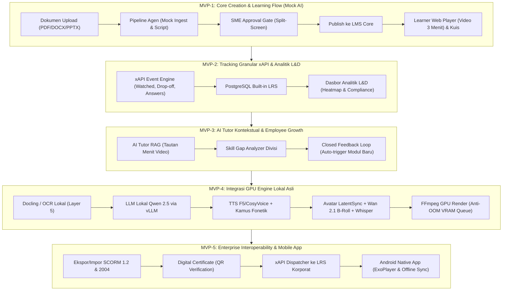
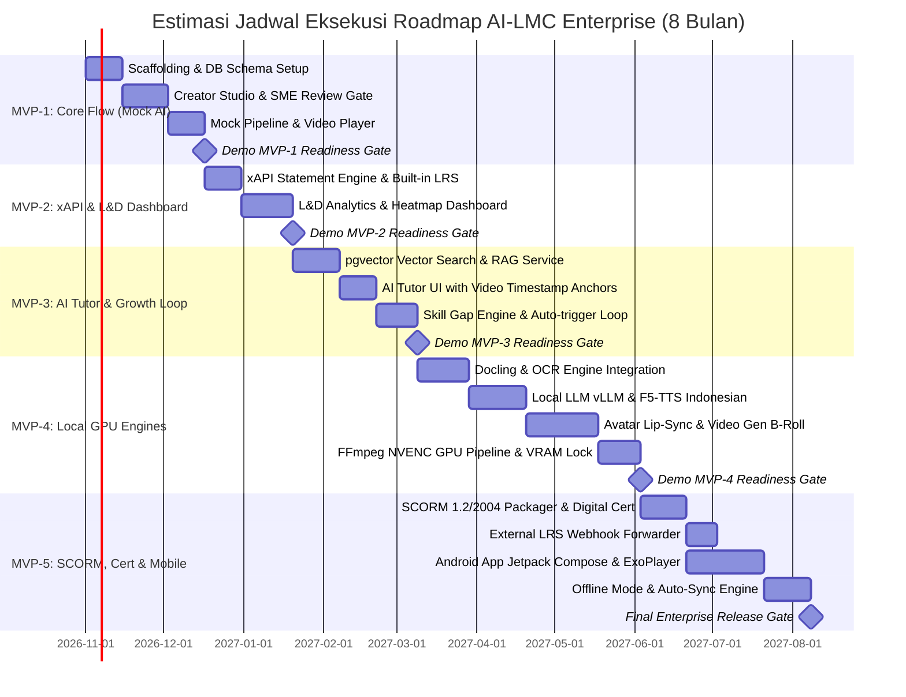

# Roadmap Implementasi Bertahap — AI-LMC Enterprise
## AI Learning Management & Creator untuk Enterprise (End-to-End)

---

## Informasi Dokumen
| Atribut | Keterangan |
| :--- | :--- |
| **Nama Proyek** | AI Learning Management & Creator (AI-LMC) Enterprise |
| **Versi Dokumen** | 1.0.0 (Proposed / Awaiting Approval) |
| **Status** | Dalam Peninjauan Pemangku Kepentingan |
| **Referensi Utama** | [docs/PRD.md](file:///d:/Projek/2026/neuronworks-ai-lmc/docs/PRD.md), [docs/decisions.md](file:///d:/Projek/2026/neuronworks-ai-lmc/docs/decisions.md), [AGENTS.md](file:///d:/Projek/2026/neuronworks-ai-lmc/AGENTS.md) |
| **Tanggal Pembuatan** | 30 Oktober 2026 |

---

## 1. Filosofi & Strategi Rilis Bertahap

Pengembangan platform AI-LMC Enterprise mengadopsi prinsip **Demo-Driven Development**:
1. **Tiap Fase Dapat Didemokan Mandiri (*Standalone Demoable*)**: Setiap fase menghasilkan fungsi yang utuh, dapat diuji secara visual, dan memiliki alur kerja yang dapat didemonstrasikan langsung ke pengguna tanpa menunggu fase berikutnya.
2. **Mitigasi Risiko Perangkat Keras (*Mock-First Architecture*)**: MVP-1 sampai MVP-3 berfokus pada penyempurnaan alur kerja web, UX, logika orkestrasi, dan LMS Core menggunakan **Mock AI Provider**. Hal ini menjamin tim tidak terhambat ketiadaan server GPU fisik di awal proyek.
3. **Penyempurnaan Bertahap (*Progressive Enhancement*)**: Model AI GPU berat (TTS, Lip-sync, Video B-roll) diintegrasikan pada MVP-4 setelah seluruh kontrak data, antarmuka SME, dan pemutar video terbukti stabil.
4. **Kepatuhan Terhadap Definition of Done (DoD)**: Seluruh fase wajib lulus linting, typechecking (`tsc --noEmit`), testing suite, serta pembaruan dokumentasi sebelum dinyatakan selesai (*Done*).

---

## 2. Diagram Alir Roadmap 5 Fase MVP

---

## 3. Rincian 5 Fase MVP

---

### MVP-1: Core Creation & Learning Flow (Mock AI)
> **Fokus Utama**: Membangun fondasi end-to-end dari upload dokumen, orkestrasi naskah, review SME, penerbitan ke LMS, pemutar video web, hingga evaluasi kuis dasar menggunakan media hasil simulasi (*Mock AI*).

#### 1. Komponen yang Dibangun
- **Layer 1 (Frontend Web)**:
  - Halaman Creator Studio: Upload berkas dokumen (PDF, DOCX, PPTX).
  - Workspace Pipeline: Status visual progres (Tahap Ingest $\rightarrow$ Outline $\rightarrow$ Script $\rightarrow$ Storyboard).
  - Antarmuka *SME Review Gate*: Tampilan split-screen (dokumen PDF di kiri, naskah per scene bersitasi di kanan, tombol *"Setujui & Render Video"*).
  - Learner Portal Web: Katalog kursus, pemutar video kustom 16:9 dengan navigasi bab dan subtitle VTT, modul pengerjaan kuis.
- **Layer 2 (LMS Core)**:
  - Database schema relasional (PostgreSQL): `users`, `divisions`, `courses`, `modules`, `scenes`, `quizzes`, `quiz_questions`, `enrollments`.
  - Service Course & Module Ingestion (API internal Go).
- **Layer 3 (AI Orchestration)**:
  - Agent Workflow (Python FastAPI): Parser dummy, Outline Generator, Scriptwriter Generator (format naskah 5 scene baku).
  - Interface Abstraction `Provider`: `LLMProvider`, `TTSProvider`, `VideoProvider`.
  - Implementasi `MockAIProvider`: Menghasilkan naskah bersitasi realistis dan menyusun master video MP4 dummy 3 menit (5 scene) dengan audio narasi dan subtitle VTT tersinkronisasi.
- **Layer 5 (Storage)**:
  - MinIO S3 bucket: `raw-documents`, `media-assets`, `rendered-videos`.

#### 2. Skenario Demo Mandiri (*Standalone Demo*)
1. Admin L&D membuka Creator Studio di browser, mengunggah dokumen `SOP_Keselamatan_Kerja.pdf`.
2. Sistem menjalankan pipeline simulasi dalam ~10 detik dan menampilkan naskah terstruktur 5 scene lengkap dengan sitasi `[Hal: X]`.
3. SME meninjau naskah di tampilan split-screen, mengedit kalimat pada Scene 2, lalu mengklik tombol **"Setujui & Render Video"**.
4. Sistem memicu mock rendering dan otomatis menerbitkan modul ke katalog LMS Core.
5. Pembelajar membuka Learner Portal Web, memilih kursus, memutar video 3 menit dengan takarir teks, dan menyelesaikan 5 butir soal kuis dengan umpan balik benar/salah langsung.

#### 3. Kriteria Penerimaan (*Acceptance Criteria*)
- [ ] Upload file PDF/DOCX/PPTX sukses tersimpan ke MinIO S3 dengan UUID aman.
- [ ] Pipeline menghasilkan draf naskah 5 scene (Pembuka, Poin 1, Poin 2, Kasus, Ringkasan) dalam waktu $< 15$ detik.
- [ ] Tampilan split-screen SME responsif, memungkinkan pengeditan teks per scene secara instan.
- [ ] Tombol render terkunci hingga persetujuan SME diberikan (*Approval Gate enforcement*).
- [ ] Video hasil render berdurasi tepat 3 menit, dapat diputar di browser dengan subtitle `.vtt` aktif.
- [ ] Kuis menampilkan 5 soal pilihan ganda, mencatat jawaban pembelajar, dan menghitung skor akhir.
- [ ] Desain UI mematuhi [rules/design.md](file:///d:/Projek/2026/neuronworks-ai-lmc/rules/design.md) (palet Night Canvas `#13111C` & Signature Purple `#853BCE`).

---

### MVP-2: Granular xAPI Tracking & L&D Analytics Dashboard
> **Fokus Utama**: Menambahkan mesin pelacak aktivitas belajar granular berstandar xAPI dan menyajikan dasbor analitik mendalam bagi manajemen L&D dan HR.

#### 1. Komponen yang Dibangun
- **Layer 5 (Learning Record Store - LRS)**:
  - Skema tabel PostgreSQL `xapi_statements`: UUID statement, actor, verb (`experienced`, `watched`, `interacted`, `answered`, `passed`, `completed`), object, result, context (`division_id`).
  - Endpoint REST / xAPI statement receiver berstandar IEEE xAPI v1.0.3.
- **Layer 2 (LMS Core Analytics)**:
  - Event Aggregator: Menghitung persentase tontonan riil, retensi per scene, deteksi seeking/skipping, dan statistik kegagalan butir kuis.
- **Layer 1 (L&D Dashboard Web)**:
  - Dasbor Analitik Divisi: Visualisasi kepatuhan (*Compliance Rate*), grafik distribusi nilai kuis, dan matriks keaktifan per departemen.
  - Video Heatmap Drop-off: Grafik retensi penonton per detik video untuk mengidentifikasi scene yang membosankan/membingungkan.
  - Question Difficulty Index: Analisis butir soal yang paling sering dijawab salah oleh karyawan.

#### 2. Skenario Demo Mandiri (*Standalone Demo*)
1. Pembelajar memutar video modul, mempercepat video (*seeking*), menonton hingga selesai, dan menjawab kuis.
2. Di balik layar, pemutar video menembakkan event xAPI secara periodik tanpa membebani browser.
3. Manajer L&D membuka Dasbor L&D, memilih divisi terkait, dan melihat data ter-refresh secara real-time:
   - Angka kepatuhan divisi bertambah.
   - Grafik heatmap menampilkan durasi tontonan riil (bukan sekadar status klik).
   - Butir soal yang dijawab salah langsung tercatat pada daftar *Question Difficulty*.

#### 3. Kriteria Penerimaan (*Acceptance Criteria*)
- [ ] Pemutar video memancarkan xAPI events secara akurat: `experienced` saat modul dibuka, `watched` per interval 5 detik, dan `completed` saat video mencapai 100%.
- [ ] Drop-off timestamp tercatat presisi bila pembelajar menutup browser di tengah video.
- [ ] Jawaban kuis menghasilkan statement `answered` beserta durasi pengerjaan dan status `passed`/`failed`.
- [ ] Dasbor L&D menampilkan metrik agregat per divisi tanpa kebocoran data antar-divisi (*Divisional RBAC compliance*).
- [ ] Grafik Heatmap dan metrik kepatuhan merender data dengan lancar tanpa latensi query yang lambat ($< 500\text{ms}$).

---

### MVP-3: AI Tutor Kontekstual & Employee Growth Loop
> **Fokus Utama**: Membangun asisten AI Tutor cerdas berbasis RAG di samping pemutar video, pemetaan kesenjangan keterampilan (*Skill Gap*), serta siklus rekomendasi tertutup (*Closed Feedback Loop*).

#### 1. Komponen yang Dibangun
- **Layer 2 (AI Tutor & RAG Engine)**:
  - Vector DB Service (pgvector): Menyimpan chunk dokumen sumber dan modul kursus.
  - Contextual Course Assistant: Endpoint chat streaming yang menerima pertanyaan pembelajar, mencari fakta pada chunk dokumen terkait, dan menghasilkan jawaban lengkap dengan rujukan stempel waktu video (*video timestamp anchor*).
- **Layer 2 (Skill Gap & Closed Loop Engine)**:
  - Pemetaan Taksonomi Kompetensi: Memetakan topik materi terhadap matriks keterampilan jabatan.
  - Algoritma Deteksi Kesenjangan: Mengidentifikasi topik yang nilainya rendah pada kuis evaluasi.
  - Pemicu Modul Otomatis (*Auto-trigger Ingestion*): Tombol aksi bagi pimpinan divisi untuk langsung memicu pembuatan draft modul baru di Creator Studio berdasarkan topik yang mengalami kesenjangan kompetensi massal.
- **Layer 1 (Web Experience)**:
  - Panel Samping AI Tutor: Antarmuka chat interaktif di samping video player dengan format pesan rapi dan tombol klik menit video.
  - Dasbor Pemetaan Skill Gap Karyawan & Divisi.

#### 2. Skenario Demo Mandiri (*Standalone Demo*)
1. Pembelajar yang sedang menonton video di menit 01:45 membuka panel AI Tutor dan bertanya: *"Mengapa helm proyek wajib warna kuning untuk area ini?"*.
2. AI Tutor menjawab secara lugas berdasar fakta dokumen SOP dan menyertakan tombol: `[Tonton Menit 01:30]`. Pembelajar mengklik tombol tersebut dan pemutar video melompat tepat ke detik terkait.
3. Setelah kuis selesai, karyawan melihat profil kompetensinya; sistem merekomendasikan materi pengayaan spesifik untuk topik yang nilainya marjinal.
4. Di dasbor pimpinan divisi, muncul notifikasi: *"Kesenjangan kompetensi terdeteksi pada 40% staf bidang K3 Listrik"*. Pimpinan mengklik **"Buat Modul Pelatihan Baru"**, dan sistem langsung membuka Creator Studio dengan tujuan pembelajaran yang terisi otomatis.

#### 3. Kriteria Penerimaan (*Acceptance Criteria*)
- [ ] AI Tutor menjawab pertanyaan secara faktual hanya berdasarkan konteks modul (RAG Relevance Score $\ge 0.85$).
- [ ] Jawaban AI Tutor menyertakan stempel waktu video yang valid dan dapat diklik untuk memajukan video secara interaktif.
- [ ] Karyawan salah menjawab kuis menerima umpan balik rasionalisasi yang akurat.
- [ ] Dasbor Skill Gap memetakan kompetensi tim secara visual (misal: grafik radar / bar kompetensi).
- [ ] Tombol pemicu modul baru berhasil mentransfer parameter topik ke Creator Studio (menutup siklus *closed feedback loop*).

---

### MVP-4: Integrasi Model GPU Lokal Asli
> **Fokus Utama**: Menggantikan Mock AI Provider dengan model AI lokal on-premise asli (Layer 4 & Layer 5) yang beroperasi pada kluster GPU server dengan manajemen VRAM anti-OOM yang ketat.

#### 1. Komponen yang Dibangun
- **Layer 5 (Knowledge & Data Processing)**:
  - Document Parser & OCR Engine lokal menggunakan **Docling (IBM)** atau Surya OCR untuk ekstraksi teks, hierarki heading, dan tabel kompleks dari PDF/DOCX/PPTX.
  - Embedding Engine lokal menggunakan **BAAI/bge-m3** (vektor dense + sparse).
- **Layer 3 (Local LLM Serving)**:
  - LLM Inference Server lokal menggunakan **Qwen 2.5 (32B Instruct)** atau Llama 3.1 via **vLLM / Ollama**.
  - Enforce JSON Schema pada output LLM.
- **Layer 4 (GPU Media Generation Worker - Python FastAPI & PyTorch)**:
  - Text-to-Speech (TTS): Integrasi **F5-TTS** / **CosyVoice** dengan modul **Kamus Fonetik (*Phonetic Lexicon*)** Bahasa Indonesia untuk akronim teknis.
  - Avatar Lip-Sync: Integrasi **LatentSync** atau **MuseTalk** untuk sinkronisasi bibir presenter virtual berbasis audio WAV.
  - Video Generation B-Roll: Integrasi model difusi lokal **Wan 2.1** / **Hunyuan Video** untuk merender ilustrasi visual per scene.
  - Subtitle Alignment: Integrasi **Whisper large-v3** (`faster-whisper`) untuk *word-level timestamps*.
  - Render Compositor: Pipeline **FFmpeg GPU (NVENC/NVDEC)** untuk penggabungan multi-track (avatar, B-roll, transisi, audio, subtitle).
- **Infrastruktur & VRAM Lock Coordinator**:
  - Worker antrean tugas berbasis **Redis + asynq / Celery** dengan koordinasi kuota VRAM untuk mencegah crash *Out of Memory*.

#### 2. Skenario Demo Mandiri (*Standalone Demo*)
1. Admin mengunggah dokumen SOP scan PDF nyata yang berisi tabel dan diagram.
2. Docling & OCR lokal mengekstrak seluruh teks dan tabel tanpa kesalahan karakter.
3. Local LLM Qwen 2.5 menyusun outline dan naskah 5 scene berbahasa Indonesia formal.
4. Setelah SME menekan tombol Approve, job antrean GPU dijalankan:
   - TTS F5 menghasilkan suara manusia Indonesia yang jernih (24kHz).
   - Avatar LatentSync menggerakkan bibir selaras dengan audio suara.
   - B-roll Wan 2.1 menghasilkan latar belakang visual yang relevan.
   - Whisper menyelaraskan subtitle.
   - FFmpeg NVENC mengompilasi video MP4 1080p dalam waktu $\le 15$ menit.
5. Video final diputar di LMS dengan kualitas visual tajam tanpa artefak deformasi bibir.

#### 3. Kriteria Penerimaan (*Acceptance Criteria*)
- [ ] Tingkat akurasi ekstraksi teks dan tabel dokumen mencapai $\ge 98\%$.
- [ ] Seluruh inferensi AI berjalan 100% lokal di atas GPU server tanpa ada data yang bocor ke internet (*Zero Data Egress*).
- [ ] Generator suara TTS menghasilkan audio jernih (24kHz) dan melafalkan istilah teknis Bahasa Indonesia dengan akurat.
- [ ] Kualitas lip-sync avatar memenuhi standar visual LSE-D tanpa artefak distorsi mulut yang janggal.
- [ ] Sistem antrean VRAM GPU terbukti stabil: **0 insiden Out of Memory (OOM)** saat memproses antrean video.
- [ ] Total durasi render video 3 menit tidak melebihi 15 menit pada spesifikasi GPU target.

---

### MVP-5: Enterprise Interoperability, Digital Certification & Mobile App
> **Fokus Utama**: Menyempurnakan interoperabilitas enterprise dengan paket SCORM, penerbitan sertifikat digital ber-QR code, pengiriman xAPI ke LRS korporat, dan peluncuran aplikasi mobile native Android.

#### 1. Komponen yang Dibangun
- **Layer 2 (Interoperabilitas Enterprise & Sertifikasi)**:
  - Generator Paket SCORM: Kemampuan mengekspor kursus ke dalam format **SCORM 1.2** dan **SCORM 2004 (3rd & 4th Edition)** menggunakan `scorm-again`.
  - Digital Certificate Engine: Pembuatan PDF sertifikat digital beresolusi tinggi otomatis dengan QR code verifikasi publik unik.
  - xAPI Dispatcher / Forwarder: Modul background yang menduplikasi statement xAPI lokal ke server LRS eksternal enterprise (Learning Locker, Watershed).
- **Layer 1 (Learner Mobile App - Kotlin Android Native)**:
  - Proyek Android Native di `/mobile-app`: Jetpack Compose UI, arsitektur MVVM, Ktor Client, Room Database.
  - Hardware-accelerated Video Player menggunakan Google **ExoPlayer**.
  - Fitur Unduh Luring (*Offline Mode*): Penyimpanan berkas video terenkripsi di penyimpanan lokal HP untuk pembelajaran karyawan di area minim sinyal.
  - Auto-Sync xAPI: Pernyataan xAPI tersimpan di antrean Room DB lokal dan otomatis tersinkronisasi ke backend saat ponsel kembali terhubung ke jaringan internet/WiFi kantor.

#### 2. Skenario Demo Mandiri (*Standalone Demo*)
1. Admin L&D mengekspor kursus yang dihasilkan AI menjadi berkas `course_scorm_2004.zip`, lalu mengimpornya ke sistem LMS eksternal (misal Moodle) dan video serta kuis berjalan sempurna.
2. Pembelajar yang lulus kuis dengan nilai $\ge 80\%$ langsung menerima tombol unduh sertifikat; saat QR code pada sertifikat di-scan menggunakan kamera HP, browser membuka halaman verifikasi resmi enterprise yang menyatakan keabsahan sertifikat.
3. Karyawan lapangan membuka aplikasi Android di ponselnya, mengunduh modul secara offline, mematikan koneksi internet (Airplane mode), menonton video, dan mengerjakan kuis hingga tuntas.
4. Begitu Airplane mode dimatikan, aplikasi mobile otomatis mengunggah seluruh rekaman aktivitas belajar ke LRS server tanpa data yang hilang.

#### 3. Kriteria Penerimaan (*Acceptance Criteria*)
- [ ] Paket SCORM 1.2 dan SCORM 2004 lulus uji validator SCORM resmi dan dapat diputar di Moodle / SCORM Cloud.
- [ ] Sertifikat digital terbit instan dengan identitas karyawan, nama kursus, tanggal kelulusan, dan QR code yang mengarah ke endpoint verifikasi publik yang sah.
- [ ] xAPI Dispatcher berhasil meneruskan data ke LRS eksternal dengan status delivery 100%.
- [ ] Aplikasi Android Native terpasang stabil di perangkat Android (Android 10+), video berputar mulus tanpa stuttering via ExoPlayer.
- [ ] Fitur offline playback berjalan lancar saat ponsel tanpa koneksi data, dan sinkronisasi xAPI berhasil saat online kembali.

---

## 4. Matriks Estimasi & Prioritas Implementasi

---

## 5. Aturan Transisi Antar-Fase (*Milestone Gates*)

Sebuah fase dinyatakan selesai dan tim diizinkan melangkah ke fase berikutnya hanya apabila:
1. **Lolos Skenario Demo Mandiri**: Seluruh skenario demo pada fase tersebut berhasil didemokan tanpa intervensi manual atau modifikasi data palsu di database.
2. **Kepatuhan Definition of Done (DoD)**:
   - Seluruh linting (`pnpm lint`, `golangci-lint`, `ruff check`) lulus 100%.
   - Typechecking (`tsc --noEmit`, `mypy`) bersih tanpa error.
   - Unit dan integration test lulus dengan cakupan minimum 80%.
3. **Dokumentasi Terkini**: Berkas `README.md` pada modul terkait dan [docs/PRD.md](file:///d:/Projek/2026/neuronworks-ai-lmc/docs/PRD.md) diperbarui jika ada penyesuaian detail teknis.
4. **Persetujuan Pemangku Kepentingan (*Sign-off*)**: Ditandatangani secara formal oleh Product Owner / Lead Architect.

